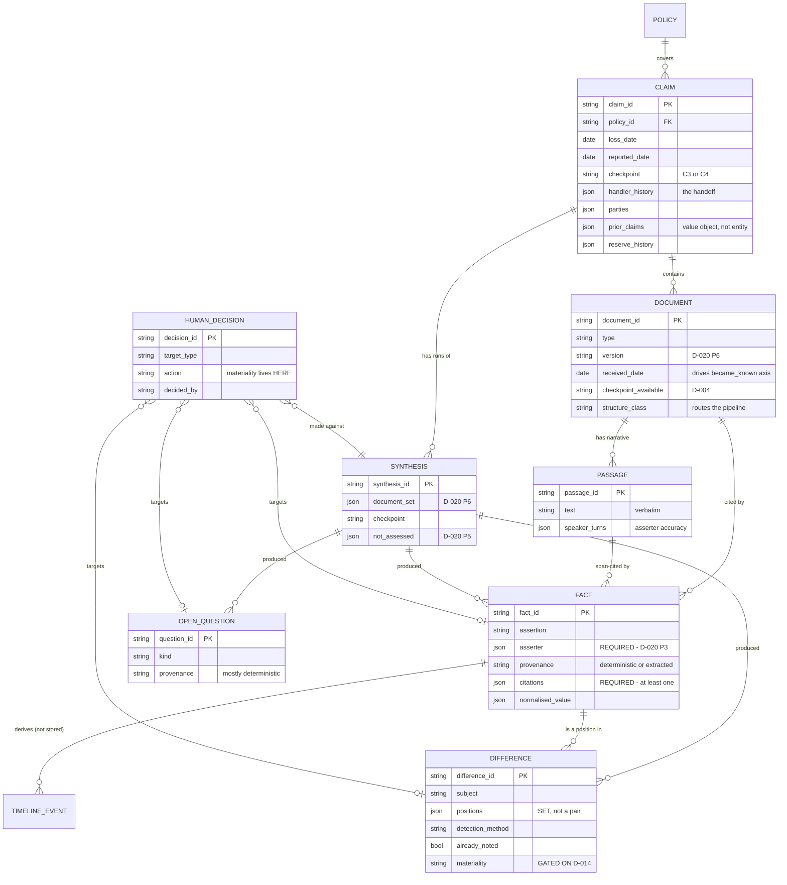

# V1 Output Contract and Domain Model

**Status:** Phase 3, **provisional**. Written on Day 2 alongside `product/v1-prd.md`.
**Date:** 2026-08-13
**Gate:** D-014 gates Phase 3 on the §12 materiality experiment. D-024 amends it: **documents may proceed, code may not**, and every materiality-dependent element is labelled `PROVISIONAL — GATED ON D-014` in place. Nothing here has been validated by a claims professional.

## How to read this document

- `§n.n` references point into `research/claims-synthesis-research.md`; `DOCMAP §` into `research/claim-document-map.md`; `PRD §` into `product/v1-prd.md`; `D-nnn` into `docs/decision_log.md`.
- **`PROVISIONAL — GATED ON D-014`** marks anything that dies if §12 metric 2 shows materiality agreement at chance. §3.6 walks the deletion and shows the model still stands.
- Types are written in a language-neutral notation. This is not a database schema and not code. V1 evaluation runs over JSON files; a database is premature (PRD §8.2).

---

# Part 1 — The output contract

## 1.1 The six concepts, and why they must never share a type

`CLAUDE.md` requires that Fact, Evidence, Conflict, Inference, and Human Decision not be collapsed into one category. D-020 P7 sharpens it: *if they share a type in the data model, they will eventually be collapsed in the UI.* The profession reached the same conclusion independently — Blake's large loss report format segregates a **Conclusions** section so subjective assessment never contaminates the factual presentation (§4.2).

| Concept | Definition here | Type | Who produces it |
| --- | --- | --- | --- |
| **Fact** | What a source explicitly states, attributed to who stated it | `Fact` | Deterministic read **or** LLM extraction |
| **Evidence** | The locatable region of a source supporting a fact | `Citation` — a value object **on** a Fact, not a type of its own | Deterministic resolution |
| **Conflict** | Two or more sources asserting different things about the same thing | `Difference` | LLM proposal, deterministic assembly |
| **Inference** | An interpretation derived from evidence rather than stated by it | **Absent from V1** — see §1.2 | — |
| **Open question** | Something the file does not resolve, or does not contain | `OpenQuestion` | Mostly deterministic |
| **Human decision** | A conclusion or action taken by the adjuster | `HumanDecision` | The human, always |

## 1.2 Why `Inference` has no type in V1

**[INFERENCE]** Nothing in V1 produces one. The header is composed of cited facts. The timeline is sorted dates. Differences are pairs of facts. Open questions are checklist results. Materiality — the one place an interpretation would live — is a `HumanDecision`, not a system output (PRD §7.4).

Defining an `Inference` type before anything needs it would create a container that later gets filled by convenience, which is the exact failure D-020 P7 warns about. **If V1 ever needs to state an interpretation, that is a decision to make deliberately, with its own log entry — not a field that was already sitting there.**

## 1.3 The output object

What one `Analyze` produces. Rendered as the five regions of PRD §6.2.

```
SynthesisResult
  synthesis_id            required   stable id for this run
  claim_id                required
  generated_at            required   timestamp
  checkpoint              required   C3 | C4                        (D-015)
  document_set            required   [DocumentVersionRef]           (D-020 P6)
  model_id                required   null if no LLM stage ran
  prompt_version          required   null if no LLM stage ran

  header                  required   ClaimHeader
  timeline                required   [TimelineEvent]     may be empty
  facts                   required   [Fact]              may be empty
  differences             required   [Difference]        may be empty
  open_questions          required   [OpenQuestion]      may be empty

  coverage                required   ProcessingCoverage
  not_assessed            required   [string]            what was NOT attempted, and why
```

Two fields carry more weight than their size suggests.

**`document_set`** — D-020 P6. Every output records which documents, at which versions, it was derived from. Without it, nobody can later establish what the system actually saw, and claim files are discoverable (§8.1).

**`not_assessed`** — D-020 P5, "absence is stated, not implied". An empty `differences` list is ambiguous between *no differences found* and *differences not assessed*. That ambiguity is dangerous given §8.2's confabulation finding and Day 1's open question 11. The list resolves it explicitly: `["physical-evidence consistency — no repair estimate in file", "materiality — not assessed by design (PRD §7.4)"]`.

## 1.4 `Citation` — evidence as a value object

```
Citation
  document_id             required
  document_version        required
  locator                 required   Locator
  quoted_text             required   verbatim, as it appears in the source
  resolved                required   bool — did this span verify against the source?
```

```
Locator                   one of:
  TextSpan       { passage_id, char_start, char_end }
  PageParagraph  { page, paragraph }
  Timestamp      { hh:mm:ss }            recorded statements
  Field          { record, field_path }  structured records
```

**Rules.**

- **P1 — span-level, never document-level.** `"FNOL"` is not a citation. `FNOL / description_of_accident / chars 412–487` is.
- **P2 — drop, never soften.** If `resolved` is false the owning Fact is **discarded**, not hedged. Hedged-but-present content is worse than absent content because it looks verified. `resolved` exists only so the drop is auditable; a `false` never reaches the screen.
- **Structured facts cite too.** A `Field` locator pointing at `policy_record.inception_date` is a citation. The user should be able to check a deterministic fact as easily as an extracted one.

**Not an entity.** A Citation has no independent identity, nothing points at it, and it never outlives its Fact. Making it an entity would add a join and a lifecycle for nothing (§3.1).

## 1.5 `Fact`

```
Fact
  fact_id                 required
  assertion               required   what is asserted, in neutral framing
  asserter                required   Asserter                       (D-020 P3)
  provenance              required   deterministic | extracted
  citations               required   [Citation]   at least one, always
  subject                 optional   what this fact is about — used to group for comparison
  normalised_value        optional   NormalisedValue
  extraction_confidence   optional   present only when provenance = extracted
  review                  optional   ReviewStatus
```

```
Asserter
  kind                    required   claimant | insured | witness | police_officer |
                                     adjuster | provider | system_record | attorney
  name                    optional   null for system_record
  party_id                optional   only when entity resolution has been CONFIRMED by a human
```

```
NormalisedValue           one of:
  Date      { value, precision: day|month|year|vague, raw_expression }
  Money     { amount, currency }
  Location  { raw, normalised }
  Boolean   { value }
  Quantity  { value, unit }
```

**Why `asserter` is required and has no default.** **[INFERENCE]** (§8.3) In a claim file, *who said this* often matters more than *what was said*. A fact asserted by a police officer, by the claimant, and by the claimant's attorney carry entirely different weight. Misattribution is the error most likely to be **invisible in evaluation and damaging in a deposition** — generic summarization benchmarks do not measure it, so PRD §12.2 measures it separately.

The `assertion` is stored in neutral framing: not *"the vehicle was parked"* but *"the vehicle was parked"* as the assertion with `asserter = claimant, document = FNOL`. The rendering layer composes those into "the FNOL records the claimant as reporting the vehicle was parked" (D-020 P3). Storing the composed sentence would bake presentation into data and make the asserter unenforceable.

**Why `Date.precision` includes `vague`.** DOCMAP §2.2 — "a few minutes later", "that evening". These **cannot be normalised to a timestamp without inventing precision**, and inventing precision on a timeline is exactly the incorrect-chronology risk. `precision: vague` with the `raw_expression` preserved is how the system carries an unusable date without discarding or falsifying it. PRD §12.2 scores invented-precision as its own metric.

**Why `party_id` is optional and requires human confirmation.** LLMs are confidently wrong at entity resolution (§7.1, U-7). "Robert Smith" and "Bob Smith" are *proposed* as the same party, never silently merged. Until a human confirms, facts stay attached to the name as written.

### Example — extracted

```json
{
  "fact_id": "f_012",
  "assertion": "The vehicle was parked and unoccupied at the time of the impact.",
  "asserter": { "kind": "claimant", "name": "Robert Smith" },
  "provenance": "extracted",
  "subject": "vehicle_state_at_impact",
  "citations": [{
    "document_id": "doc_fnol",
    "document_version": "v1",
    "locator": { "TextSpan": { "passage_id": "fnol.description_of_accident",
                               "char_start": 412, "char_end": 487 } },
    "quoted_text": "my car was parked on the street, nobody was in it",
    "resolved": true
  }]
}
```

### Example — deterministic

```json
{
  "fact_id": "f_003",
  "assertion": "The loss was reported 6 days after the reported date of loss.",
  "asserter": { "kind": "system_record" },
  "provenance": "deterministic",
  "normalised_value": { "Quantity": { "value": 6, "unit": "days" } },
  "citations": [
    { "document_id": "rec_claim", "document_version": "v1",
      "locator": { "Field": { "record": "claim_record", "field_path": "loss_date" } },
      "quoted_text": "2026-02-14", "resolved": true },
    { "document_id": "rec_claim", "document_version": "v1",
      "locator": { "Field": { "record": "claim_record", "field_path": "reported_date" } },
      "quoted_text": "2026-02-20", "resolved": true }
  ]
}
```

A derived fact cites **both operands**. The arithmetic is code (PRD §11); the citation makes it checkable without trusting the code.

## 1.6 `TimelineEvent` — derived, two axes

```
TimelineEvent
  event_id                required
  axis                    required   occurred | became_known
  when                    required   NormalisedValue.Date
  label                   required
  source_fact_ids         required   [fact_id]   at least one
  ordering_confidence     required   exact | approximate | unorderable
```

**Derived, never stored.** Computed from Facts carrying a `normalised_value` of type Date. Storing it would create two sources of truth for the same date and let them drift.

**Two axes, both required in the output.** **[INFERENCE]** (§10.3) The `occurred` axis is the chronology of the loss. The `became_known` axis is when each fact entered the file — when the police report arrived, when the reserve changed, when the attorney letter came in. **The second is what a successor actually needs and is what a chronology of the loss alone does not give them.** Reserve *changes* in particular signal when the predecessor's view of severity shifted (DOCMAP §1.1).

**`ordering_confidence = unorderable`** is what a `precision: vague` date produces. The event still appears; it is not silently dropped and not given a false position.

**No LLM sorts this.** Ordering is arithmetic over normalised dates (PRD §10.4). A model touching this is a regression against DOCMAP §4.

## 1.7 `Difference` — a set of positions, not a pair

```
Difference
  difference_id           required
  subject                 required   what the sources disagree about
  positions               required   [Position]   at least TWO
  detection_method        required   deterministic | extracted
  already_noted           required   bool + optional fact_id of the adjuster note
  review                  optional   ReviewStatus
  materiality             optional   PROVISIONAL — GATED ON D-014
  materiality_rationale   optional   PROVISIONAL — GATED ON D-014
```

```
Position
  fact_id                 required
  stance                  required   the assertion, as that source has it
```

**Why `positions` is a set, not two fields.** **[INFERENCE]** Three-way disagreement is real and common: the FNOL, the recorded statement, and the police report narrative can each say something different about the direction of travel. A schema with `fact_a` / `fact_b` would force either a rewrite or three pairwise "differences" describing one disagreement. This is the single change most likely to save a migration later (§3.3).

**Why `detection_method` exists.** Three of the ten conflict pairs in DOCMAP §3 need **no LLM at all** — pair 4 (stated driver not a listed driver), pair 8 (requested but never received), pair 10 (impossible chronology). They are among the most materially consequential rows and the cheapest to implement. Recording which path found a difference lets us evaluate the two independently and stops a deterministic finding from inheriting a model's error bar.

**Why `already_noted` exists.** DOCMAP §2.4: adjuster notes are where a discrepancy the predecessor *already spotted* is written down. A system that confidently re-reports something the file already resolved will destroy trust on first contact. This is a failure mode no public benchmark measures, and it is eval category 12 in PRD §9.3.

**The gated fields.** `materiality` and `materiality_rationale` exist so the shape is visible, and are **not populated by V1** (PRD §7.4). The system never asserts materiality. If §12 metric 2 comes back at chance, both fields are deleted and the product ships as "differences noted, materiality not assessed" — §12.6's narrowed-scope branch, pre-built. §3.6 shows the deletion is clean.

### Example

```json
{
  "difference_id": "d_002",
  "subject": "vehicle_state_at_impact",
  "detection_method": "extracted",
  "already_noted": { "value": false },
  "positions": [
    { "fact_id": "f_012", "stance": "The vehicle was parked and unoccupied." },
    { "fact_id": "f_047", "stance": "The vehicle was travelling northbound at roughly 25 mph." }
  ]
}
```

No materiality. No characterisation of either party. Two positions, each resolving to a span and an asserter.

## 1.8 `OpenQuestion`

```
OpenQuestion
  question_id             required
  question                required
  kind                    required   expected_document_absent
                                   | requested_never_received
                                   | unresolved_by_file
  provenance              required   deterministic | extracted
  expected_source         optional   what would answer it
  supporting_citations    optional   e.g. the correspondence that made the request
  related_difference_id   optional
  review                  optional   ReviewStatus
```

**Mostly deterministic, and that is the point.** `expected_document_absent` is a checklist against expected documents for the claim type. `requested_never_received` is date arithmetic over correspondence — a request with no matching arrival (DOCMAP §3 pair 8). Neither needs a model. This is the **lowest-risk, cheapest high-value output in the product**, and the hedge if assumption A1 fails (PRD §7.5).

**Why `supporting_citations` is optional here but `citations` is required on Fact.** An open question about something *absent* has nothing to cite. That is the one place in this model where the drop-if-uncitable rule cannot apply, and it is why `OpenQuestion` cannot be a `Fact` with a status — see §3.2.

## 1.9 `ClaimHeader`

The structured replacement for the narrative summary (D-025, PRD §7.2). Subheads taken from large loss report practice (§4.2).

```
ClaimHeader
  coverage                required   HeaderField
  loss_description        required   HeaderField
  jurisdiction            required   HeaderField
  damages                 required   HeaderField
  status                  required   HeaderField
  reserve                 required   HeaderField
```

```
HeaderField
  value                   required   short text, or null
  state                   required   present | absent_from_file | not_assessed
  fact_ids                required   [fact_id]   empty ONLY when state != present
```

**Every field is individually cited and individually falsifiable.** This is what makes the header safer than prose: there is no long generation for hallucinations to cluster at the end of (§8.2), and no room for the generic-vacuity failure, because a field either resolves to facts or declares itself absent.

**`state` is required and has three values, not two.** "Absent from the file" and "we did not look" are different things and must be distinguishable (D-020 P5).

## 1.10 `HumanDecision`

```
HumanDecision
  decision_id             required
  synthesis_id            required   which synthesis version this was made against
  target_type             required   fact | difference | open_question | party_merge
  target_id               required
  action                  required   accept | dismiss | correct | merge | reject_merge
                                   | mark_material | mark_immaterial | mark_unsure
  rationale               optional   free text
  decided_by              required
  decided_at              required
```

```
ReviewStatus              (value object, shared by Fact / Difference / OpenQuestion)
  state                   required   unreviewed | accepted | dismissed | corrected
  latest_decision_id      optional
```

**Why this is a first-class entity and not a flag.** Three reasons, in increasing order of importance:

1. D-020 P8 requires that every proposal a human accepts or rejects is captured.
2. D-013 identifies these markings as the most valuable evaluation data available, and the **only realistic path to measuring materiality agreement in production**.
3. A flag records the current state; an entity records **who decided what, when, and against which version of the synthesis**. In a discoverable file that distinction is the whole point.

**`mark_material` is a HumanDecision, never a system output.** This is where materiality lives in V1 (PRD §7.4). Note that these actions remain valid even if the gated `Difference.materiality` field is deleted — the human's judgment is still worth capturing when the system's is not.

## 1.11 The contract, at a glance

| Type | AI or deterministic | Human can verify by | Citations |
| --- | --- | --- | --- |
| `ClaimHeader` | Assembled deterministically from Facts | Clicking each field to its facts | Via `fact_ids` |
| `Fact` (deterministic) | Deterministic | Checking the source record field | Required |
| `Fact` (extracted) | **LLM** | Reading the quoted span in the document | Required |
| `Citation` | Deterministic resolution | Reading the source | — |
| `TimelineEvent` | Deterministic (derived) | Checking each event's source facts | Via `source_fact_ids` |
| `Difference` | **LLM** proposal, or deterministic | Reading both positions' spans | Via positions' facts |
| `OpenQuestion` | Mostly deterministic | Checking the file for the named document | Optional by necessity |
| `HumanDecision` | Human only | It is their own record | — |

---

# Part 2 — The domain model

## 2.1 Approach

Built from the workflow in PRD §6.1, not from database conventions. Every entity had to justify itself against one question: **does the V1 product need it, or does it just look tidy?** `CLAUDE.md` warns against adding entities because they seem architecturally elegant. Three candidates from the initial list did not survive (§3.1).

## 2.2 Entities

### `Claim` — stored

**Purpose.** The root. Everything hangs off it.

| Field | Req | Source | Notes |
| --- | --- | --- | --- |
| `claim_id` | ✅ | assigned | |
| `claim_number` | ✅ | claim record | |
| `policy_id` | ✅ | claim record | → `Policy` |
| `loss_date` | ✅ | claim record | |
| `reported_date` | ✅ | claim record | |
| `loss_location` | ⬜ | claim record | |
| `claim_type` | ✅ | claim record | Drives the completeness checklist |
| `status` | ✅ | claim record | |
| `checkpoint` | ✅ | authored | C3 or C4. **D-004 / D-015 — every fixture is authored *as of* a checkpoint.** |
| `handler_history` | ✅ | claim record | `[{handler, from, to}]` — **the handoff the product exists for** |
| `parties` | ✅ | claim record | `[Party]` |
| `prior_claims` | ⬜ | claims system / ISO | `[PriorClaimSummary]` — a value object, not an entity (§3.1) |
| `reserve_history` | ⬜ | claims system | `[{amount, set_at, set_by}]` — feeds the `became_known` axis |

**`handler_history` earns its place** even though it looks like metadata: it is the field that identifies the moment the product is for, and the segment filter in PRD §2.2 reads from it.

### `Policy` — stored, separate from Claim

**Purpose.** The coverage frame, and one side of a materially consequential deterministic check.

| Field | Req | Source |
| --- | --- | --- |
| `policy_id`, `policy_number` | ✅ | policy admin system |
| `inception_date`, `expiry_date` | ✅ | policy admin system |
| `listed_drivers` | ✅ | policy admin system |
| `scheduled_vehicles` | ✅ | policy admin system |
| `coverages` | ✅ | policy admin system |
| `garaging_address` | ⬜ | policy admin system |
| `lapse_history` | ⬜ | policy admin system |

**Why separate from `Claim`.** DOCMAP §3 pair 4 — stated driver vs. listed driver, garaging vs. stated usage. A **deterministic check, materially consequential, and it needs the policy as an addressable object with its own citable fields**. Flattening it onto Claim would make those citations point at the wrong record.

### `Document` — stored

**Purpose.** The unit of provenance. Everything cited resolves through here.

| Field | Req | Notes |
| --- | --- | --- |
| `document_id` | ✅ | |
| `claim_id` | ✅ | |
| `type` | ✅ | fnol · policy_record · recorded_statement · police_report · adjuster_notes · repair_estimate · correspondence · witness_statement · prior_claims_summary · … |
| `version` | ✅ | Required by D-020 P6 |
| `received_date` | ✅ | **Drives the `became_known` timeline axis** |
| `checkpoint_available` | ✅ | C1–C5. Enforces D-004 — documents not yet available at the run checkpoint are withheld |
| `structure_class` | ✅ | `structured` · `structured_with_narrative` · `unstructured` · `non_text` (DOCMAP §4) |
| `structured_fields` | ⬜ | For FNOL, estimate, etc. |
| `passages` | ⬜ | `[Passage]` — only for the narrative half |

**`structure_class` is the field that routes the pipeline.** DOCMAP §4 sorts the file into four classes, and the class decides whether a document is read by code, by a model, or not at all. Putting it on the document makes the deterministic-first principle enforceable rather than aspirational: a `structured` document that reached an LLM is a bug the data can expose.

### `Passage` — stored

**Purpose.** The addressable region of narrative text. The unit an LLM is given, and the unit a `TextSpan` offsets into.

| Field | Req | Notes |
| --- | --- | --- |
| `passage_id` | ✅ | e.g. `fnol.description_of_accident` |
| `document_id` | ✅ | |
| `label` | ✅ | "Description of Accident", "Officer narrative", "Statement body" |
| `text` | ✅ | Verbatim |
| `speaker_turns` | ⬜ | `[{speaker, char_start, char_end, timestamp?}]` — recorded statements only |

**Why a separate entity rather than a field on Document.** **[INFERENCE]** Three reasons that only became clear from DOCMAP §2.1–2.2. An FNOL has ~100 structured fields and one or two narrative boxes — the LLM must receive **only the boxes**, and a Passage is what makes that expressible. Character offsets need a stable origin, and a document with mixed structured and narrative content has no single origin. And `speaker_turns` is what makes asserter accuracy checkable in a transcript: without it, the leading-question failure ("so you were stopped at the light?") is unverifiable, and that is the highest-consequence error type in the model (§8.3, DOCMAP §2.2).

### `Fact`, `Difference`, `OpenQuestion`, `HumanDecision` — stored

As specified in Part 1. Facts and Differences are stored rather than recomputed because `HumanDecision` must be able to point at a stable target across sessions, and because re-running a model would produce different ids for the same finding.

### `Synthesis` — stored, versioned

**Purpose.** One `Analyze` run. The `SynthesisResult` of §1.3, persisted.

**Why it must be versioned.** D-020 P6, and the reason is legal rather than technical: claim files are discoverable, and without a version stamped against its document set, **nobody can later establish what the system actually saw** (§8.1). It is also the precondition for the deferred diff view (PRD §7.3).

### `Party` — value object on Claim

| Field | Req | Notes |
| --- | --- | --- |
| `party_id` | ✅ | |
| `name_as_written` | ✅ | **As it appears in the source. Never normalised.** |
| `role` | ✅ | insured · claimant · driver · passenger · witness · officer · provider · attorney |
| `merge_candidates` | ⬜ | `[{party_id, proposed_by, confirmed_by}]` |

**`merge_candidates` is a proposal list, not a merge.** LLMs are confidently wrong at entity resolution (§7.1, U-7). "Robert Smith" and "Bob Smith" stay two parties until a human confirms, and the confirmation is a `HumanDecision` with `action: merge`. **A silent merge is the source-confusion failure in §8.3** — two people's accounts fused into one narrative — and it is invisible once it has happened.

## 2.3 Relationships



`TIMELINE_EVENT` appears in the relationships but has no table: it is derived from Facts at render time (§1.6, §2.4).

## 2.4 Stored vs. derived, at a glance

| Entity | Stored? | Reason |
| --- | --- | --- |
| `Claim`, `Policy`, `Document`, `Passage` | **Stored** | Input. Immutable per version. |
| `Fact`, `Difference`, `OpenQuestion` | **Stored** | `HumanDecision` needs stable targets across sessions |
| `Synthesis` | **Stored, versioned** | D-020 P6, and discoverability (§8.1) |
| `HumanDecision` | **Stored** | The most valuable evaluation data available (D-013) |
| `TimelineEvent` | **Derived** | Recomputed from Facts. Storing creates two sources of truth for one date. |
| `Citation` | **Value object on Fact** | No identity, nothing points at it, never outlives its Fact |
| `Party` | **Value object on Claim** | Only becomes interesting when merged, and a merge is a `HumanDecision` |
| `PriorClaimSummary` | **Value object on Claim** | §3.1 |
| `ClaimHeader` | **Derived** | Assembled from Facts at render time |

---

# Part 3 — Challenging the model

## 3.1 What was cut, and why

### `Evidence` as an entity → cut

It is a `Citation` value object owned by a Fact (§1.4). It has no independent identity, nothing points at it, and it never outlives its owner. Making it an entity would add a join and a lifecycle for nothing.

`CLAUDE.md` lists Evidence as a candidate entity, and the research answers this directly: evidence is **"not a section — a property of every other section"** (§10.3). The same holds one level down. It is a property of every Fact.

### `PriorClaim` as an entity → cut

Reduced to a `PriorClaimSummary` value object on `Claim`. In V1 prior claims are used for exactly two things: a **count and recency** (deterministic, §7.1) and — for eval category 11 — a comparison of prior damage against currently claimed damage.

The first needs no entity. The second needs prior-claim *detail* that DOCMAP §3 pair 6 says is **rarely present in the file at all**. Modelling a full `PriorClaim` now would be modelling data we do not have, for a capability rated high-difficulty and low-confidence. **Revisit if** pair 6 is actually built and the fixtures show the detail exists.

### `TimelineEvent` as a stored entity → cut

Derived (§1.6). Storing it duplicates every date already on a Fact and lets the two drift. There is no query V1 needs that the derived form cannot answer.

### `Inference` as a type → cut

§1.2. Nothing in V1 produces one, and an empty container gets filled by convenience.

### A `Signal` entity → cut

Carried in `CLAUDE.md`'s initial domain model from the fraud era. D-017 removed fraud from V1. There is no V1 output it would hold, and reintroducing it would smuggle back the framing D-017 removed.

## 3.2 What was NOT combined, and why (resolves D-023)

**D-023 asked: are `Fact`, `Conflict`, and `OpenQuestion` one entity with a status field, or three?**

The case for one is real. Large loss report practice attaches status labels to individual items — *"Related and justified," "Unrelated," "Those requiring further inquiry"* (§4.2) — which reads as one entity with a resolution status. §4.2 explicitly flagged this as a Phase 3 question.

**Decision: three types, sharing one `ReviewStatus` value object** (D-027).

The reasoning is that Blake's labels are a **status on an item, not the item's identity**, and the three types differ on every axis that matters:

| | `Fact` | `Difference` | `OpenQuestion` |
| --- | --- | --- | --- |
| **Requires an asserter** | ✅ always | ✗ — a difference has no single asserter | ✗ — nobody asserted an absence |
| **Requires a citation** | ✅ always (D-020 P2) | Via its positions | ✗ **cannot** — nothing to cite about a missing document |
| **Requires ≥2 facts** | ✗ | ✅ by definition | ✗ |
| **Typical provenance** | Both paths | Mostly LLM | Mostly deterministic |
| **Characteristic failure** | Hallucination, misattribution | False positive on ordinary inconsistency | Correct but obvious |

The citation row alone is decisive: `OpenQuestion` **cannot** satisfy the drop-if-uncitable rule, because an absence has nothing to cite. A single type would need the rule to be conditional on a status enum — and a conditional safety rule is a safety rule that will eventually be evaluated wrong.

**[INFERENCE]** The deeper argument is D-020 P7's: collapsing these makes the fact/conflict/question distinction a runtime enum. Enums get defaulted, dropped in serialisation, and rendered uniformly. `CLAUDE.md`'s central principle — do not collapse these categories — would then depend on every consumer remembering to branch. Three types make the distinction structural.

**What they do share:** `ReviewStatus`, because "has a human looked at this and what did they say" is genuinely the same question for all three.

## 3.3 What would make this model difficult to evolve

**[INFERENCE]** Honest inventory of where this will hurt.

| Weakness | Consequence | Partial mitigation now |
| --- | --- | --- |
| **`Difference.subject` is a free string** | Grouping facts for comparison depends on the model producing consistent subject labels across documents. If it says `vehicle_state` in one place and `was_car_moving` in another, the comparison never happens. **This is a silent recall failure — nothing errors, a difference simply never surfaces.** | Constrain to a controlled vocabulary derived from DOCMAP §3's conflict pairs. E1 should measure subject-label consistency across runs. |
| **No `Injury` / `Treatment` entity** | The injury layer (DOCMAP §1.2) is hundreds to thousands of pages with its own structure. Adding it later means new entities, not new fields. | Deliberate. V1 is the non-medical file (D-019). The medical layer is where incumbents already are. |
| **`Document.structured_fields` is untyped JSON** | An FNOL, an estimate, and a policy record have nothing in common structurally. Typing them means one schema per document type. | Accepted for a 10–50 claim evaluation set. Revisit at real ingestion. |
| **Citation offsets break if a document is re-OCR'd** | Every span in every synthesis becomes unresolvable at once. | `Document.version` and the `document_set` stamp make the break **visible** rather than silent — a re-OCR produces a new version, and old syntheses stay pinned to the old one. |
| **No representation of a fact's strength or evidentiary weight** | A sworn EUO statement and a casual remark in correspondence are structurally identical here. DOCMAP §1.1 notes proof of loss and EUO carry higher weight *because they are sworn*. | Deliberate. Weight is a judgment, and V1 does not make judgments. `Asserter.kind` carries enough for a human to weigh it themselves. |
| **`Difference` cannot express a difference of *degree*** | "$4,200" vs "$4,850" is a different kind of thing from "parked" vs "moving", and treating them identically will produce noise on numeric fields. | Not solved. Flag for the fixtures: eval should include a numeric near-miss and see what happens. |

## 3.4 What information should never be persisted

**[INFERENCE]** Claim files are discoverable and may be read aloud in a deposition years later (§8.1, D-012). This list is a design constraint, not a style guide.

| Never persist | Why |
| --- | --- |
| **A materiality judgment attributed to the system** | Materiality is the regulator's own filter (10 CCR § 2698.36) **[REGULATION]** and a human decision (PRD §7.4). A stored system materiality value would, in discovery, read as the insurer's position. |
| **Any characterisation of a person's credibility** | "The claimant's account is inconsistent" attributes a property to a person. "The FNOL and the recorded statement differ about X" attributes a property to documents. Only the second is stored. |
| **Any fraud score, suspicion flag, or referral recommendation** | D-017, D-002. Also: in California a referral creates a legal obligation on the SIU. **[REGULATION]** |
| **Any unciteable extracted content** | D-020 P2. Not "stored but hidden" — **dropped.** Hidden content is discoverable content. |
| **A silently merged party identity** | The merge is a `HumanDecision` with an author. An unattributed merge is an unattributable error. |
| **Raw model output before span resolution** | It contains, by construction, whatever was dropped. Storing it preserves exactly the material the drop rule exists to eliminate. |
| **Anything written back to a system of record** | D-028. V1 persists nothing to the claim file. D-012 remains open. |

**[INFERENCE]** One caution on the last row that cuts the other way, and it is unresolved: the same discoverability that argues for persisting little also argues for persisting *enough to reconstruct what the system did*. D-020 P6's `document_set` stamp is the compromise. Whether it is sufficient is D-012's remaining question.

## 3.5 What information is missing from this model

Named rather than added, per `CLAUDE.md`'s warning against entities that merely look elegant:

1. **No user or session model.** Not needed to evaluate 10–50 fixtures. `HumanDecision.decided_by` is a string until it needs to be more.
2. **No document-request tracking entity.** `OpenQuestion.kind = requested_never_received` is currently derived on the fly from correspondence. If it becomes central — the Concept B path in PRD §7.5 — it likely wants its own `Request` entity with a state machine. **That is the first thing to add if A1 turns out false.**
3. **No representation of "what changed since last time".** Deferred with the feature (PRD §7.3). The `Synthesis` version stamp is the precondition; the diff itself is not modelled.
4. **No confidence calibration on `extraction_confidence`.** The field exists but has no defined scale, because a model-reported confidence with no calibration data is decoration. E1 should establish whether it correlates with anything before the field is used for anything.

## 3.6 If the D-014 gate closes: the deletion walk

Per D-024, the gated elements must be removable without touching the rest. Walking it explicitly, because a claim like that is worthless unverified:

**Delete:** `Difference.materiality`, `Difference.materiality_rationale`, and the `mark_material` / `mark_immaterial` / `mark_unsure` values from `HumanDecision.action`.

**What survives unchanged:** `Fact` (never referenced materiality). `Citation`. `TimelineEvent`. `OpenQuestion`. `ClaimHeader`. `Synthesis`. `Difference` itself — `subject`, `positions`, `detection_method`, `already_noted`, and `review` are all independent of materiality. `HumanDecision` keeps `accept` / `dismiss` / `correct` / `merge` / `reject_merge`, which is still exactly the D-013 evaluation signal.

**What the product becomes:** "differences noted, materiality not assessed" — §12.6's narrowed-scope branch. The `not_assessed` list in §1.3 already carries the string that says so.

**Nothing else moves.** No entity is deleted, no relationship changes, no field type changes. The gate closing costs three fields and three enum values.

**And if A1 fails instead** (the acquisition pivot, PRD §7.5): delete `Passage`, `Fact.provenance = extracted` and everything downstream of it, and `Difference` entirely. `Claim`, `Policy`, `Document`, deterministic `Fact`, `TimelineEvent`, `OpenQuestion`, `Synthesis`, and `HumanDecision` all survive — a working, mostly-deterministic completeness product. **That is the de-scoping-not-rebuild property the PRD claims**, and this is what it rests on.
